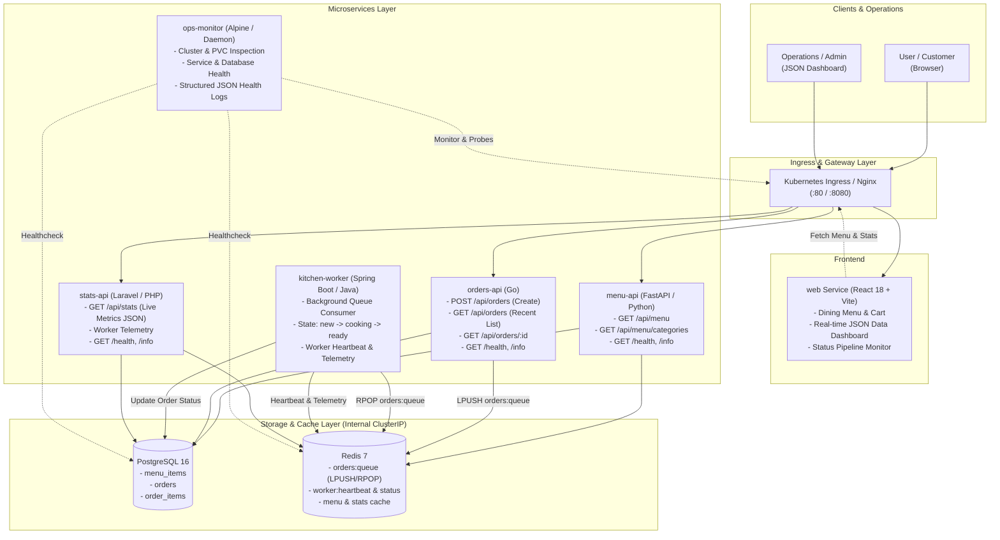
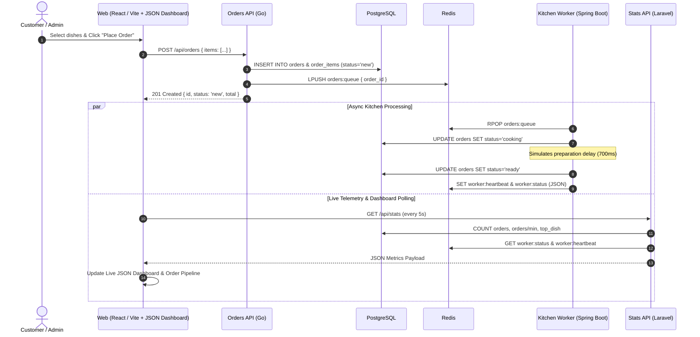

# Dhaba Orders — Production on Kubernetes

A seven-service restaurant ordering application plus an `ops-monitor` image:
React/Vite web with real-time JSON Data Dashboard, FastAPI menu API, Go orders API, Java/Spring kitchen worker, Laravel stats API, PostgreSQL, and Redis.

## System Architecture Diagram



## Order Lifecycle & Data Flow



## Microservices Overview

| Service | Technology | Port | Primary Responsibilities |
| :--- | :--- | :--- | :--- |
| **`web`** | React 18, Vite, Nginx | 80 / 8080 | Customer dining interface, cart, order placement, and live **JSON Data Dashboard** |
| **`menu-api`** | FastAPI, Python 3.12 | 8000 | Menu catalog retrieval, categorized dish listings, and Redis caching |
| **`orders-api`** | Go 1.22, `database/sql` | 8080 | Order creation, recent order querying, validation, and enqueueing to Redis |
| **`kitchen-worker`** | Spring Boot 3, Java 21 | Background | Consumes orders from `orders:queue`, transitions order states (`cooking` → `ready`), emits heartbeats |
| **`stats-api`** | Laravel 11, PHP 8.3 | 8081 | Real-time ordering metrics, order velocity, top dishes, and worker status telemetry |
| **`ops-monitor`** | Alpine Linux 3.20, Bash | Cron/Daemon | Health checks across cluster nodes, pods, PVCs, HTTP endpoints, and databases |
| **`postgres`** | PostgreSQL 16 Alpine | 5432 | Primary ACID persistence for menu items, orders, and order items |
| **`redis`** | Redis 7 Alpine | 6379 | In-memory message queue for orders and ephemeral status cache |

## JSON Data Dashboard

The web application includes an interactive **JSON Data Dashboard** accessible directly from the header navigation:

- **Live KPI Metrics**: Total orders, order velocity (orders/minute), top ordered dish, and worker heartbeat.
- **Service Architecture Grid**: Real-time status for all microservices (`web`, `menu-api`, `orders-api`, `kitchen-worker`, `stats-api`, `postgres`, `redis`).
- **Interactive JSON Inspector**:
  - Live inspection tabs for `/api/stats`, `/api/menu`, `/api/orders`, and consolidated aggregated telemetry.
  - Search and filter keys or values within JSON payloads.
  - One-click "Copy JSON" to clipboard.
  - "Download .json" file export.
  - Auto-refresh toggle (every 5 seconds) with manual refresh option.
- **Order Pipeline Lifecycle Tracker**: Visual representation of order progression through stages (`new` → `cooking` → `ready`).

## Local development

Requirements: Docker + Docker Compose.

```bash
docker compose up --build
```

Open http://localhost:8080. The web container proxies `/api/menu`, `/api/orders`,
`/api/stats`, and `/api/orders/...` to the corresponding services. PostgreSQL and
Redis are internal-only. Demo database initialization runs automatically.

Useful endpoints:
- `GET /api/menu`: List available dishes
- `GET /api/orders`: List recent orders and queue status
- `POST /api/orders`: Place new order with `{"items":[{"dish_id":1,"quantity":2}]}`
- `GET /api/orders/{id}`: Fetch single order by ID
- `GET /api/stats`: Retrieve live order analytics and worker telemetry JSON

## Kubernetes / CI

1. Replace `TEAM`, AWS account/region, hostnames and image registry placeholders.
2. Create Kubernetes Secrets from `k8s/examples/secrets.example.env`; do not commit real secrets.
3. Create ECR repositories with `scripts/create-ecr-repos.sh`.
4. Apply a Kustomize overlay: `kubectl apply -k k8s/overlays/staging`.
5. Configure GitHub repository secrets: `AWS_ROLE_ARN`, `AWS_REGION`, `ECR_REGISTRY`,
   `KUBE_CONFIG_STAGING`, `KUBE_CONFIG_PRODUCTION`, `SLACK_WEBHOOK_URL`.
6. Configure GitHub OIDC trust for the repository and a `production` Environment
   with required reviewers.
7. Set branch protection to require the CI workflow checks and one PR approval.

The workflow is a practical reference implementation. The cluster is outside AWS;
the included ECR refresh CronJob uses a short-lived AWS web-identity token mounted
from a Kubernetes ServiceAccount. This requires an AWS IAM OIDC provider/trust
configuration for the cluster's identity issuer and is intentionally not enabled
until your trainer supplies the issuer/role details. Do not put AWS keys in Git.

## Important deployment notes

- Staging and production each have their own PostgreSQL and Redis PVCs.
- PostgreSQL and Redis are ClusterIP-only; no NodePort/Ingress.
- `k8s/base` contains shared resources. Overlays set hostnames and replica counts.
- Set real secrets in the cluster before deploying.
- The included manifests are a learning baseline; validate against your cluster
  version and review resource sizing, network policies, backups, TLS and security
  before real customer use.
- GitHub-hosted runners need network access to the cluster ingress and Kubernetes
  API for deployment. Restrict the deploy ServiceAccount to staging/production.

## Team workflow

Branch and PR titles begin with the Jira issue key, e.g. `DHB-12-orders-retry`.
Every change goes through a PR. Do not push directly to `main`.
